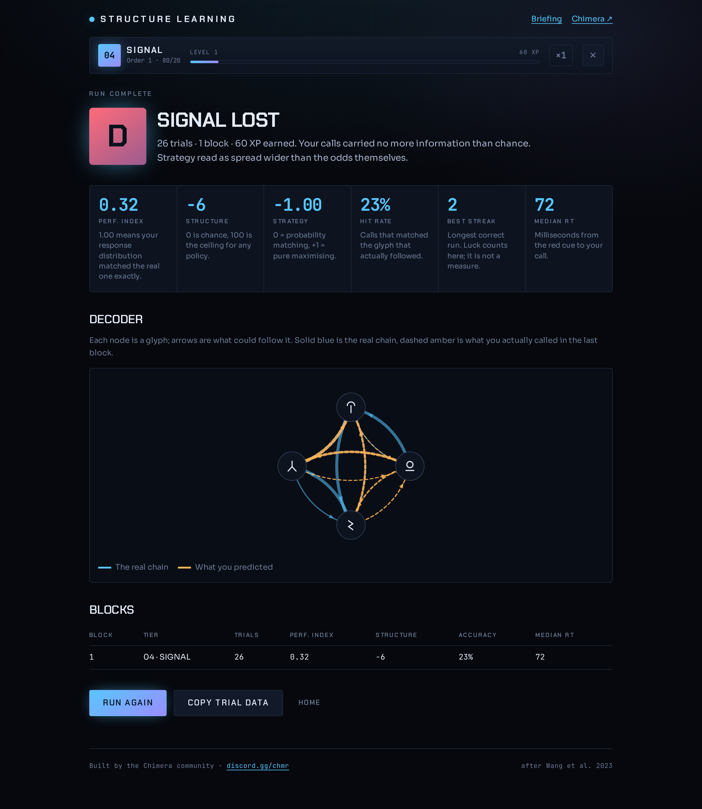

# Structure Learning Trainer

A browser rebuild of the Cambridge **structure-learning task** — the predictive statistical-sequence
paradigm from Zoe Kourtzi's lab. Four unfamiliar glyphs stream past; the order is generated by a
hidden Markov chain; you predict what comes next. Ten tiers, adaptive difficulty, research-grade
scoring, and a CSV export of every trial.

Built by the [Chimera community](https://discord.gg/chmr).
New here? **[Read the three-page plain-language guide](docs/what-this-is.pdf)** — what it is, what
the exercise does, and what the numbers mean, with no jargon.



---

## Run it

**Locally** — clone or download, then open `index.html` in any modern browser. That's it. One file,
no build step, no dependencies, no server. It works offline apart from the webfonts, which fall back
cleanly.

```bash
git clone https://github.com/<you>/structure-learning-trainer.git
cd structure-learning-trainer
open index.html          # macOS   (Windows: start index.html  ·  Linux: xdg-open index.html)
```

**On the web** — push this repo to GitHub, then *Settings → Pages → Source: deploy from branch →
`main` / `(root)`*. Your copy goes live at `https://<you>.github.io/structure-learning-trainer/`
within a minute or two. `.nojekyll` is already in the repo so nothing gets mangled.

---

## What the exercise is

Each trial plays **9–13 glyphs**, one at a time, at a fixed 500 ms onset-to-onset rhythm. A red dot
ends the stream and you call the next glyph from a 2×2 grid (keys `1`–`4`).

The stream is not random. It comes from a Markov chain where **every context permits exactly two
successors with uneven odds** — 85/15 at the bottom of the ladder, down to 65/35 near the top. At the
highest tiers the context becomes the *last two* glyphs rather than one. You are never told the rule;
you learn it only from the statistics of what you see.

The chain is rebuilt for every run, so what improves is your ability to extract structure — not your
memory of one particular chain.

### The tier ladder

| # | Code | Structure | Feedback | Notes |
|---|------|-----------|----------|-------|
| 1 | STATIC | Base rates only | Every trial | No context yet |
| 2 | DRIFT | Base rates, flatter | Every trial | Rates pulled closer |
| 3 | TRACE | Order 1 · 85/15 | Every trial | Two successors per glyph |
| 4 | SIGNAL | Order 1 · 80/20 | Every trial | The canonical Wang et al. condition |
| 5 | CIPHER | Order 1 · 75/25 | Block only | Feedback thins out |
| 6 | PHANTOM | Order 1 · 70/30 | Block only | Odds harder to separate |
| 7 | MIRAGE | Order 1 · 65/35 | Block only | Timing jitter added |
| 8 | LATTICE | Order 2 · 85/15 | Every trial | Context = last two glyphs |
| 9 | HELIX | Order 2 · 80/20 | Block only | |
| 10 | ORACLE | Order 2 · 70/30 | None | No feedback at all |

On the adaptive setting you climb a tier whenever your structure score clears 60 in a block, and drop
one after two blocks under 15. Any tier can also be pinned from the setup panel.

---

## What the numbers mean

| Metric | Range | What it is |
|---|---|---|
| **Structure score** | 0–100 | How much of the available predictive value your calls actually captured. 0 is chance, 100 is the ceiling for any policy. This is the honest headline measure, and it drives the adaptive ladder. |
| **Performance index** | 0–1 | Overlap between your response distribution and the true transition distribution, computed the way the source papers compute it. 1.00 means you reproduced the statistics exactly. |
| **Strategy** | −1 to +1 | 0 is probability matching (answering 80/20 when the world is 80/20); +1 is pure maximising (always taking the likely branch). Both are ways of being right, and Wang et al. found this index explained an extra 34.7% of the variance in post-training performance. |
| **Hit rate** | 0–100% | Calls that matched the glyph that actually followed. Capped by the chain — at 80/20, 80% is the best anyone can do. |
| **XP, levels, streaks** | — | Entertainment. They make a long run bearable. They are not measures of anything, and a hot streak on a 20% branch is luck. |

### Data export

"Copy trial data" on the debrief screen puts the whole run on your clipboard as CSV:

```
run, started_at, block, trial, tier_id, tier_code, tier_name, markov_order,
feedback, glyph_ms, context, p0, p1, p2, p3, sequence, response, actual, correct, rt_ms
```

`sequence` is the pipe-joined stream that was shown, `context` is the conditioning state, `p0`–`p3`
are the true transition probabilities for that context, and `response`/`actual` are glyph indices
0–3. That is everything you need to recompute any of the metrics yourself, or to run a real
pre-registered pilot with an active control.

All progress lives in `localStorage` in your own browser. Nothing is uploaded anywhere; there is no
backend and no analytics.

---

## Honest notes on the evidence

The task itself has real work behind it. In Wang, Gates, Shen, Tino & Kourtzi (2023, *Frontiers in
Neuroscience*, N = 105), trial-by-trial feedback produced a 33.2 ± 3.6% improvement, block-level
feedback 23.5 ± 3.9%, and even the no-feedback group improved 19.0 ± 3.9%, with gains largely held
four weeks later. Pushing the odds to 60/40 collapsed learning to 4.6 ± 2.2%.

What is **not** established is that any of this transfers to anything else:

- The Cambridge transfer trial (NCT05611788) is complete but **unpublished** as of September 2026.
- The brain-training meta-analyses are blunt that far transfer sits near zero — Gobet & Sala (2023)
  conclude the overall effect of far transfer is null; Au et al. (2015) reanalysed comes to g = 0.13,
  losing significance once studies without active controls are excluded.

So: this is a well-instrumented rebuild of a research task, useful for near-transfer practice,
measurement and curiosity. It is not a device for raising your IQ, and nobody should sell it to you
as one.

### References

- Wang, Gates, Shen, Tino & Kourtzi (2023). *Front. Neurosci.* 17:1195388 — task, feedback arms, performance & strategy indices
- Wang et al. (2017). *J. Neurosci.* 37:8412–8427 — the original paradigm
- Karlaftis et al. (2019). *Nat. Hum. Behav.* 3:297–307 — mechanistic and imaging basis
- Liu et al. (2023). *Trials* 24:517 — staged adaptive training protocol
- Gobet & Sala (2023). *Perspect. Psychol. Sci.* 18(1):125–141 — the far-transfer null
- Au et al. (2015). *Psychon. Bull. Rev.* 22:366–377 — n-back meta-analysis and its reanalysis

---

## Implementation notes

Single file, vanilla JavaScript, no framework and no build. Chain construction, sequence generation,
the metrics and the decoder graph are all in the one `<script>` block at the bottom of `index.html`.

A few things worth knowing if you fork it:

- **Chains are validated, not just sampled.** Order-1 chains are regenerated until the graph is
  strongly connected over all four glyphs, so no glyph is unreachable. Order-2 chains are grown by
  breadth-first closure with a soft cap on the number of reachable contexts, which keeps them
  learnable inside a block. Immediate repeats are excluded at both orders.
- **The adaptive ladder is driven by the structure score, not the performance index.** The
  performance index penalises maximisers by construction, so using it to drive difficulty stalls
  anyone with a sensible strategy at the harder tiers.
- **Sound never plays during a stream.** Adding an auditory stream on top of the visual one would
  change the paradigm. Audio is limited to the cue, your response, feedback and tier-ups.
- **"Lab grey" chamber** in the setup panel swaps the stimulus field to mean-luminance grey, which is
  the convention in the vision-science implementations, if you want to stay closer to the original.

## Contributing

Issues and PRs welcome. Come talk about it in the Chimera Discord: **[discord.gg/chmr](https://discord.gg/chmr)**.

## License

MIT — see [LICENSE](LICENSE). The paradigm itself is the published work of the Kourtzi lab and their
co-authors; this is an independent reimplementation for public use, not affiliated with or endorsed
by the University of Cambridge.
